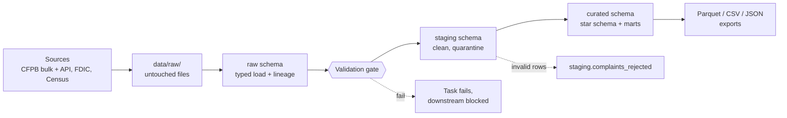

# CFPB Complaint Resolution Data Engineering Pipeline

**Group Epsilon** | DSS150P - Fundamentals of Data Engineering | Mapúa University

A reproducible, automated pipeline that ingests, validates, integrates and curates about 18 million CFPB consumer complaints and enriches them with FDIC institution financials and U.S. Census demographics. It follows the Medallion architecture (Raw → Staging → Curated), runs on PostgreSQL, is orchestrated by Apache Airflow and is containerized with Docker Compose.

## Table of Contents

1. [Project Overview](#1-project-overview)
2. [Team and Ownership](#2-team-and-ownership)
3. [Data Sources](#3-data-sources)
4. [Architecture](#4-architecture)
5. [Documentation Index](#5-documentation-index)
6. [Repository Structure](#6-repository-structure)
7. [Getting Started](#7-getting-started)
8. [Running the Pipeline](#8-running-the-pipeline)
9. [Data Quality, Validation and Contracts](#9-data-quality-validation-and-contracts)
10. [Testing](#10-testing)
11. [Verification and Demo Guide](#11-verification-and-demo-guide)
12. [Troubleshooting](#12-troubleshooting)
13. [Known Limitations and Assumptions](#13-known-limitations-and-assumptions)
14. [Future Improvements](#14-future-improvements)
15. [Final Deliverables](#15-final-deliverables)

---

## 1. Project Overview

### Problem statement

Consumers file millions of complaints about financial products with the CFPB, but the raw database cannot answer the questions regulators, analysts and journalists actually ask:

- Where and when are complaints rising, and in which products?
- Do complaints track state-level demographics such as poverty and income?
- Which banks draw the most complaints relative to their size, and do large banks respond more slowly than small ones?

Complaints name a company, not a bank record. They carry a state code, not demographic context. They contain anomalies (for example, 7,050 complaints sent to the company before they were received) and arrive daily through an API that caps results per query. Answering these questions requires integrating three independent sources.

### Stakeholders

| Stakeholder | What they need |
| --- | --- |
| **Regulators and policy analysts** | Trends by state, product and bank size; response-time performance |
| **Data analysts and BI developers** | A clean star schema and marts they can query without cleaning anything |
| **Data scientists** | Analysis-ready, typed, partitioned Parquet files |
| **Course instructors and reviewers** | A reproducible, documented, rerunnable pipeline with visible quality controls |

### What the pipeline produces

| Output | Location |
| --- | --- |
| Star schema (1 fact, 5 dimensions, 1 bridge) | PostgreSQL schema `curated` |
| Monthly complaint mart and institution scorecard | `curated.mart_complaints_monthly`, `curated.mart_institution_scorecard` |
| Partitioned Parquet, scorecard in Parquet / CSV / JSON | `data/curated/` |
| Validation report per gate | `outputs/validation/` |
| Format benchmark and partition demo | `outputs/format_comparison/` |

---

## 2. Team and Ownership

| Member | Role | Components owned |
| --- | --- | --- |
| **Ashley Galit** | FDIC code compiler | `extract_fdic.py`, `load_fdic.py`, `validate_fdic.py`, `stage_fdic.sql`, FDIC profiling |
| **Derek Tyler Ong** | Census and curated code compiler | `extract_census.py`, `load_census.py`, `validate_census.py`, `stage_census.sql`, `build_curated.*`, `build_mart.*`, `validate_curated.py`, `validate_mart.py`, `export/*`, `contracts/census_state.yml` |
| **Thazel Tumaneng** | CFPB code compiler | `extract_cfpb_bulk.py`, `extract_cfpb_api.py`, `load_cfpb*.py`, `validate_cfpb.py`, `stage_cfpb.sql`, `contracts/cfpb_complaints.yml` |

Shared: Airflow DAG, Docker setup, tests, documentation. Each member is expected to demonstrate and defend the components listed against their name.

---

## 3. Data Sources

| Source | Provider | Access | Format | Volume | Refresh | Key | Auth |
| --- | --- | --- | --- | --- | --- | --- | --- |
| **CFPB Complaints, bulk** | CFPB | Download of `complaints.csv.zip` | CSV | ~18.2M rows | One-time bootstrap | `complaint_id` | None |
| **CFPB Complaints, API** | CFPB | Paginated Search API | JSON | Daily increments | Daily (watermark minus 14-day lookback) | `complaint_id` | None |
| **FDIC BankFind Institutions** | FDIC | REST API, filter `ACTIVE:1`, 1,000 per page | JSON (plus Parquet copy) | ~4,200 institutions, 150 source columns | Each DAG run | `cert` | None |
| **Census ACS 5-year (2022)** | U.S. Census Bureau | REST API, `for=state:*` | JSON (list of lists) | 52 rows (50 states, DC, Puerto Rico) | Each DAG run | `state_fips` | Optional key |

**Census variables extracted**

| Variable | Meaning |
| --- | --- |
| `B01003_001E` | Total population |
| `B19013_001E` | Median household income |
| `B17001_002E` | Population below the poverty line |
| `B02001_002E` | White alone |
| `B02001_003E` | Black or African American alone |

---

## 4. Architecture

### 4.1 Medallion layers



The full source-by-source diagram, with joins and quarantine handling, is in [`docs/lineage.md`](docs/data_lineage.md).

| Layer | Schema / folder | Purpose | Allowed | Not allowed |
| --- | --- | --- | --- | --- |
| **Files** | `data/raw/` | Permanent, replayable copy of every extract | Save API responses and downloads untouched, with ingestion metadata | Any transformation |
| **Raw** | `raw` | Source data as received, plus lineage | Typed load, primary keys, `ingested_at`, `source_system`, `batch_id` | Cleaning, joins |
| **Staging** | `staging` | Filtered, cleaned, validated | Trim, standardize, derive fields, quarantine invalid rows | Joins across sources |
| **Curated** | `curated` | Integrated single source of truth | Cross-source joins, surrogate keys, constraints, marts | Source-specific cleaning |

### 4.2 Curated model (ERD)

The ERD is in [`docs/erd.md`](docs/erd.md). Field-level detail for every table is in [`docs/data_dictionary.md`](docs/data_dictionary.md).

| Table | Grain | Source | Notes |
| --- | --- | --- | --- |
| `curated.fact_complaints` | One row per complaint | CFPB staging | PK `complaint_id`; foreign keys to the dimensions; indexed on date, year/month, state, company, institution |
| `curated.dim_company` | One row per company name | CFPB staging | Identity surrogate key; `company_key` is the normalized name used for matching |
| `curated.dim_product` | Product x sub-product | CFPB staging | |
| `curated.dim_issue` | Issue x sub-issue | CFPB staging | |
| `curated.dim_geography` | One row per state or territory | Census | Joined on state abbreviation through a FIPS reference table |
| `curated.dim_institution` | One row per active FDIC institution | FDIC | Includes `asset_tier` |
| `curated.bridge_company_institution` | One row per matched company | Derived | Links CFPB company to FDIC institution |
| `curated.mart_complaints_monthly` | Month x state x product x asset tier | Fact + dimensions | Data product |
| `curated.mart_institution_scorecard` | Institution x year | Fact + `dim_institution` | Data product |

### 4.3 Key design decisions

| Decision | Explanation |
| --- | --- |
| **Files before database** | Every extract is saved to `data/raw/` first, so any load can be replayed without calling the source again. |
| **Quarantine, never silently drop** | Invalid CFPB rows go to `staging.complaints_rejected` with a reject reason. The runner checks that `staged + rejected = raw`. |
| **Validation gates raise exceptions** | A failed check raises `ValidationError`, which fails the Airflow task and blocks all downstream tasks. |
| **Contracts define the rules** | CFPB validation rules are read from `contracts/cfpb_complaints.yml`, so the contract and the validator cannot drift apart. |
| **Atomic rebuilds** | Staging and curated SQL run as one transaction, so readers never see a half-built table and a failure leaves the previous version in place. |
| **Idempotent loads** | Raw CFPB API loads upsert on `complaint_id`, the bulk load skips if data exists, and Parquet partitions are replaced, not appended. |
| **Bridge table for FDIC** | A CFPB company name does not map one-to-one to an FDIC institution, so matching is explicit, ranked and auditable. |
| **Incremental after bootstrap** | The full CSV is loaded once. Daily runs pull only new complaints through the API and upsert them. |
| **Docker Compose for parity** | One `docker compose up` gives every teammate the same PostgreSQL, Airflow and Python environment. |

---

## 5. Documentation Index

| Document | What it contains |
| --- | --- |
| [`docs/data_dictionary.md`](docs/data_dictionary.md) | Grain, keys, columns, types, nullability, meanings, allowed values and quality rules for the key raw, staging and curated tables |
| [`contracts/`](contracts/) | Machine-readable data contracts. `cfpb_complaints.yml` is executed by the validator; `census_state.yml` documents the Census checks implemented in code |
| [`docs/lineage.md`](docs/lineage.md) | Data flow from each source to exports, join catalog, quarantine and failure handling, rerun behaviour, DAG task map |
| [`docs/erd.md`](docs/erd.md) | Entity-relationship diagram of the curated layer |
| [`sql/queries/representative_queries.sql`](sql/queries/representative_queries.sql) | Example analytical queries on the curated layer |
| [`sql/queries/row_counts.sql`](sql/queries/row_counts.sql) | Row counts, duplicate checks and raw = staged + rejected reconciliation |

---

## 6. Repository Structure

```
DSS150P_Project_Epsilon/
├── README.md
├── requirements.txt
├── Dockerfile                        # Airflow 2.7.1 / Python 3.10 + project dependencies
├── docker-compose.yml                # postgres, airflow-init, webserver, scheduler
├── run_verification.sh               # scripted end-to-end verification (section 11)
├── .env.example                      # copy to .env (never commit .env)
├── .gitignore
├── config/                           # mounted into Airflow containers
├── contracts/                        # data contracts (mounted into Airflow)
│   ├── cfpb_complaints.yml
│   └── census_state.yml
├── dags/
│   └── medallion_architecture_pipeline.py
├── data/                             # git-ignored
│   ├── raw/                          # untouched extracts: complaints.csv, cfpb_api/, fdic/, census/
│   ├── staging/                      # staging reference Parquet
│   └── curated/                      # partitioned Parquet and mart files
├── docs/                             # mounted into Airflow (tests read the dictionary)
│   ├── data_dictionary.md
│   ├── lineage.md
│   └── erd.md
├── logs/                             # Airflow task logs (git-ignored)
├── notebooks/                        # source profiling scripts (profile_cfpb, profile_fdic, profile_census)
├── outputs/
│   ├── cfpb_profiling/  fdic_profiling/  census_profiling/
│   ├── validation/                   # CSV report per gate + pipeline_summary_history.csv
│   └── format_comparison/            # format benchmark and partition demo
├── sql/
│   ├── init/01_init_schema.sql       # database, schemas, raw tables (first start only)
│   ├── reference/state_fips_seed.sql # state abbreviation <-> FIPS map
│   ├── staging/                      # 00_functions, stage_cfpb, stage_fdic, stage_census
│   ├── curated/                      # build_curated.sql, build_mart.sql
│   └── queries/                      # representative_queries.sql, row_counts.sql
├── src/
│   ├── extract/                      # extract_cfpb_bulk, extract_cfpb_api, extract_fdic, extract_census
│   ├── load/                         # load_cfpb, load_cfpb_api, load_fdic, load_census, cfpb_common
│   ├── transform/                    # stage, build_curated, build_mart
│   ├── validation/                   # common, contracts, pipeline_summary, validate_cfpb/fdic/census/curated/mart
│   ├── export/                       # export_curated, benchmark_formats, read_partition_demo
│   └── utils/                        # config, db, http, logging_config
└── tests/                            # pytest suite (26 tests)
```

---

## 7. Getting Started

### Prerequisites

- Docker and Docker Compose
- Python 3.10 or newer for running the steps locally (the Airflow image uses 3.10; local runs were verified on 3.12)

### Dependencies (`requirements.txt`)

`pandas==2.3.3`, `requests==2.34.2`, `psycopg2-binary==2.9.13`, `python-dotenv==1.2.3`, `pyarrow==25.0.1`, `pytest==9.1.1`, `curl_cffi`, `ijson`, `scipy`, `statsmodels`, `matplotlib`, `plotly`, `pyyaml`

### Configuration

```bash
cp .env.example .env     # fill in local values, never commit .env
```

| Variable | Purpose |
| --- | --- |
| `POSTGRES_HOST`, `POSTGRES_PORT`, `POSTGRES_DB`, `POSTGRES_USER`, `POSTGRES_PASSWORD` | Database connection (`POSTGRES_HOST=localhost` for local runs; the containers use the service name `postgres`) |
| `AIRFLOW_WWW_USER_USERNAME`, `AIRFLOW_WWW_USER_PASSWORD` | Airflow UI login |
| `CFPB_BULK_MIN_DATE` | Optional. Load only complaints on or after this date (`YYYY-MM-DD`) for a fast demo slice instead of all 18M rows |
| `MAX_REJECT_PCT` | Failing-row percentage allowed before an error rule becomes FAIL (default 1.0) |

### Local environment (for the manual steps and the tests)

```bash
python3 -m venv .venv
source .venv/bin/activate
pip install -r requirements.txt
```

---

## 8. Running the Pipeline

### Option A: Airflow (orchestrated)

```bash
docker compose up -d --build     # postgres, airflow-init, webserver, scheduler
docker compose ps                # all services should be Up / healthy
```

1. Open http://localhost:8080 and log in with the credentials from `.env`.
2. Find `medallion_architecture_pipeline` and unpause it.
3. Click **Trigger DAG** (or wait for the `@daily` schedule).
4. Watch the task graph. The first run downloads and loads the full CFPB CSV (about 18 million rows) and takes a long time. Later runs are incremental and fast.

The DAG runs `@daily` with `catchup=False`, `max_active_runs=1`, 2 retries per task and no retries for the validation gates. Business logic lives in `src/`; the DAG only wires tasks together.

```bash
docker compose logs -f airflow-scheduler      # follow the scheduler
docker compose down                           # stop (data volume is kept)
docker compose down -v                        # stop AND delete the database volume (full reset)
```

### Option B: Manual CLI (step by step)

```bash
docker compose up -d postgres

# ---------- CFPB ----------
python -m src.extract.extract_cfpb_bulk            # skipped if complaints.csv exists (--force to re-download)
python -m src.load.load_cfpb                       # skipped if table has rows (--force to reload, --min-date for a slice)
python -m src.extract.extract_cfpb_api --lookback-days 14    # also: --since, --until, --probe
python -m src.load.load_cfpb_api                   # upsert on complaint_id
python -m src.validation.validate_cfpb             # gate (rules from contracts/cfpb_complaints.yml)
python -m src.transform.stage cfpb                 # raw -> staging (+ quarantine)

# ---------- FDIC ----------
python -m src.extract.extract_fdic
python -m src.load.load_fdic
python -m src.validation.validate_fdic             # gate
python -m src.transform.stage fdic

# ---------- Census ----------
python -m src.extract.extract_census
python -m src.load.load_census
python -m src.validation.validate_census           # gate
python -m src.transform.stage census

# ---------- Curated and data products ----------
python -m src.transform.build_curated              # star schema (several minutes on 18M rows)
python -m src.validation.validate_curated          # gate
python -m src.transform.build_mart                 # view + two marts
python -m src.validation.validate_mart             # gate

# ---------- File layer ----------
python -m src.export.export_curated                # add --since-year 2026 to refresh only recent partitions
python -m src.export.benchmark_formats --rows 200000
python -m src.export.read_partition_demo           # add --year 2026 --month 8 for a specific partition

# ---------- Query the results ----------
docker compose exec -T postgres psql -U airflow -d cfpb_pipeline -f /dev/stdin < sql/queries/representative_queries.sql

# ---------- Source profiling ----------
python -m notebooks.profile_cfpb      # needs raw CFPB data loaded in PostgreSQL
python -m notebooks.profile_fdic      # uses the latest raw file, or fetches one
python -m notebooks.profile_census    # needs one raw Census file from extract_census
```

Order matters: validate before stage for each source, all three sources staged before `build_curated`, curated before the marts, and the marts before the export.

### Inspecting the staging tables

The staging tables are created at run time and are not stored in the repository. After a run:

```bash
docker compose exec postgres psql -U airflow -d cfpb_pipeline
```
```sql
\dt staging.*
SELECT * FROM staging.complaints LIMIT 10;
SELECT reject_reason, COUNT(*) FROM staging.complaints_rejected GROUP BY 1;
SELECT * FROM staging.fdic_institutions LIMIT 10;
SELECT * FROM staging.census_state;
```

---

## 9. Data Quality, Validation and Contracts

### 9.1 Validation gates

Validation runs after every major stage. Each validator builds a list of checks, writes a CSV report to `outputs/validation/` and calls `enforce()`, which raises `ValidationError` if any check fails. That fails the Airflow task and stops everything downstream.

| Status | Meaning |
| --- | --- |
| **PASS** | No failed rows |
| **WARN** | Failures are within tolerance (default 1.0%), or the rule is warning-only |
| **FAIL** | An error-level rule exceeds its tolerance. The pipeline stops |

*Latest recorded run (October 2026). Exact counts change as new complaints arrive.*

| Gate | Script | Result | Report | What it covers |
| --- | --- | --- | --- | --- |
| **CFPB (raw)** | `validate_cfpb.py` | 8 checks: 6 PASS, 2 WARN | `validation_report.csv` | Table not empty, duplicate IDs, null core fields, invalid timely enum, missing or negative SLA lag, future dates, ZIP format, freshness within 14 days |
| **FDIC (raw JSON)** | `validate_fdic.py` | 11 checks: 10 PASS, 1 WARN | `fdic_validation_report.csv`, `fdic_flagged_records.csv` | Duplicate CERT, row-count floor, metadata count, null core keys, state codes, asset values, active flag, ZIP, established dates |
| **Census (raw)** | `validate_census.py` | 5 checks: 5 PASS | `census_validation_report.csv` | Schema columns, exactly 52 rows, unique FIPS, FIPS format, positive population and income |
| **Curated** | `validate_curated.py` | 8 checks: 7 PASS, 1 WARN | `curated_validation_report.csv` | Fact rows equal staged rows, unique IDs, no orphan keys, valid lag and date range, 52 states, state match rate, FDIC crosswalk matched |
| **Marts** | `validate_mart.py` | 6 checks: 6 PASS | `mart_validation_report.csv` | Marts not empty, totals reconcile to the fact table, percentages between 0 and 100, internal consistency |

### 9.2 Quarantine

CFPB rows that break a rule are written to `staging.complaints_rejected` with a `reject_reason`, never dropped silently. Staging fails if `staged + rejected` does not equal the raw row count.

| `reject_reason` | Condition |
| --- | --- |
| `null_core_field` | `date_received`, `product` or `company` is NULL |
| `invalid_timely_enum` | `timely_response` is not NULL and not `Yes` / `No` |
| `missing_or_negative_sla_lag` | `date_sent_to_company` is NULL or earlier than `date_received` |
| `future_date_received` | `date_received` is after today |

### 9.3 Data contracts

Contracts live in [`contracts/`](contracts/) and record dataset, version, grain, keys, columns, types, nullability, allowed values and the action on violation (fail, quarantine or warn).

| Contract | Table | Status |
| --- | --- | --- |
| `cfpb_complaints.yml` | `raw.raw_cfpb_complaints` | **Executed.** `validate_cfpb.py` loads its rules through `src/validation/contracts.py`; changing a rule or tolerance in the YAML changes the validation result |
| `census_state.yml` | `raw.raw_census_state` | Documentation. Checks are implemented in `validate_census.py` |

Contract rules use `tolerance_pct: default` to mean `MAX_REJECT_PCT`. The FDIC and curated contracts are described in [`docs/data_dictionary.md`](docs/data_dictionary.md).

---

## 10. Testing

```bash
docker compose up -d postgres     # needed by the idempotency tests
pytest -q -rs
```

**Latest result (October 2026): `26 passed in 0.88s`**

| Test file | Tests | Covers |
| --- | --- | --- |
| `test_cfpb_api.py` | 7 | API client: envelope parsing, window splitting by date, product and state, gap reporting, retry on HTTP 429 |
| `test_export.py` | 6 | Partition writing, replace-not-append behaviour, export helpers |
| `test_loaders_and_validation.py` | 5 | Loader normalization, `enforce`, `write_report` |
| `test_contracts.py` | 6 | Contract structure, contract columns match the raw table, rules load with severity and tolerance, bad contract rejected, every contract column is in the data dictionary |
| `test_idempotency.py` | 2 | Upserting the same batch twice creates no duplicates; a repeat load refreshes the existing row |

The idempotency tests need PostgreSQL and skip themselves if it is not reachable. They use complaint IDs far above real CFPB numbers and delete their rows afterwards.

---

## 11. Verification and Demo Guide

### 11.1 Scripted run

```bash
source .venv/bin/activate
bash run_verification.sh
```

The script runs the tests, the full pipeline, a negative test of the contract, snapshots, the SQL checks and two Airflow runs. Before the Airflow section, confirm `docker-compose.yml` mounts the new folders under the Airflow services (`x-airflow-common` → `volumes`):

```yaml
    - ./contracts:/opt/airflow/contracts
    - ./docs:/opt/airflow/docs
```

### 11.2 Demo checklist (in this order)

| # | Show | How | Expected |
| --- | --- | --- | --- |
| 1 | Successful DAG run | Airflow UI, `medallion_architecture_pipeline` | All tasks green |
| 2 | One validation report | `outputs/validation/validation_report.csv` | Checks with PASS / WARN status |
| 3 | Final row counts | `python -m src.validation.pipeline_summary --label after_run1` and `sql/queries/row_counts.sql` | Counts per table, `OK (no duplicates)`, raw = staged + rejected |
| 4 | Repeat run | Trigger the DAG again, then `pipeline_summary --label after_run2` | No duplicate keys; change is 0 apart from genuinely new complaints |
| 5 | Partition replacement | Count `part-0.parquet` files under `data/curated/fact_complaints/` before and after the second run | Same count, no appended duplicates |
| 6 | Contract drives validation | Set `invalid_zip_format` to `severity: error` in `contracts/cfpb_complaints.yml`, run `validate_cfpb`, then revert | Validation fails, proving the YAML controls the rules |

### 11.3 Why a repeat run creates no duplicates

| Stage | Mechanism |
| --- | --- |
| Raw CFPB bulk | Skipped when the table already has rows |
| Raw CFPB API | `INSERT ... ON CONFLICT (complaint_id) DO UPDATE` |
| Raw FDIC and Census | Upsert on `cert` and `state_fips` |
| Staging, curated, marts | Dropped and rebuilt in one transaction |
| Parquet fact partitions | Written to a temp directory, then swapped in (replace-partition) |

### 11.4 Snapshot tool

`python -m src.validation.pipeline_summary --label <name>` counts rows and distinct keys in every raw, staging and curated table, appends the result to `outputs/validation/pipeline_summary_history.csv`, shows the change since the previous snapshot, and exits with code 1 if any table has duplicate keys. Inside Airflow:

```bash
docker compose exec airflow-scheduler python -m src.validation.pipeline_summary --label after_airflow_run
```

---

## 12. Troubleshooting

| Symptom | Likely cause | Fix |
| --- | --- | --- |
| `validate_cfpb` fails in Airflow with "Data contract not found" | `./contracts` is not mounted | Add the mounts from section 11.1, then `docker compose up -d --build` |
| Port 5432 already in use | A local PostgreSQL is running | Find it with `lsof -i :5432` and stop that service |
| Idempotency tests are skipped | Postgres is not running or not healthy yet | `docker compose up -d postgres`, wait until `docker compose ps` shows healthy, rerun with `pytest -rs` to see the reason |
| Database errors after changing credentials | The database volume keeps the old password | `docker compose down -v`, then start again (this deletes the data) |
| CFPB API requests blocked | The API rejects standard Python clients | The extractor uses `curl_cffi`; make sure it installed from `requirements.txt` |
| First run takes very long | Full 18M-row bulk load | Set `CFPB_BULK_MIN_DATE` in `.env` for a demo slice |

---

## 13. Known Limitations and Assumptions

| Area | Limitation or assumption |
| --- | --- |
| **FDIC matching** | Matching uses normalized names, not a shared key. Only about 6.9% of complaints (1,260,308 of 18.2M) link to an FDIC institution, most likely because many complained-about companies (for example credit bureaus and debt collectors) are not FDIC-insured banks. Some name collisions may resolve to the wrong institution. |
| **Closed banks** | The FDIC extract requests active institutions only, so complaints about banks that have since closed do not match. The FDIC loader upserts and never deletes, so an institution that closes later is not removed from `raw.raw_fdic_institutions`. |
| **Census vintage and grain** | Demographics are ACS 2022 5-year estimates at state level only. They do not change between runs, and no county or ZIP detail is available. |
| **Surrogate keys** | `company_id`, `product_id` and `issue_id` are regenerated on every curated rebuild, so they are stable within a build but not across builds. Use natural keys (`company_name`, `cert`, `complaint_id`) when comparing runs. |
| **Full rebuilds** | Staging, curated and marts are rebuilt in full on each run (a deliberate trade-off for atomicity and simplicity). The curated build takes several minutes on 18M rows. |
| **API cap** | The CFPB API cannot page past about 10,000 hits per query, so busy windows are split automatically. Any split gap is logged, not silently ignored. |
| **CFPB API access** | The API blocks standard Python HTTP clients at the TLS level, so the extractor uses `curl_cffi` (browser impersonation). This depends on the provider's current behaviour. |
| **State coverage** | About 0.4% of complaints have no usable state and therefore no Census context. |
| **Contracts** | Only the CFPB contract's row rules are executed from YAML. The other validators still define their checks in code. |
| **Single database server** | PostgreSQL hosts both pipeline data and Airflow metadata (separate databases) on one container, fine for a course project, not for production. |
| **Executor and security** | `LocalExecutor`, credentials in `.env` and no TLS between containers are suitable for development only. |
| **Historical data** | Complaints are upserted, so a complaint the CFPB later updates is refreshed, but one the CFPB deletes is not removed from raw. |

---

## 14. Future Improvements

1. Add a CI workflow (GitHub Actions) that runs `pytest` and a lint step on every pull request.
2. Add alerting (email or Slack) in `notify_failure` instead of log-only notification.
3. Make staging and curated loads incremental (merge only changed partitions) to shorten daily runs.
4. Use stable, hash-based surrogate keys so dimension keys survive rebuilds.
5. Improve company-to-institution matching with the FDIC LEI field (about 54% populated) and fuzzy matching with a review queue.
6. Handle closed institutions by tracking FDIC status changes (slowly changing dimension).
7. Add county-level Census data to unlock finer geographic analysis.
8. Drive every validator from its data contract, not only the CFPB one.

---

## 15. Final Deliverables

| Deliverable | Location |
| --- | --- |
| Source code and pipeline | [Group_Epsilon_GitHub_Repository](https://github.com/Ixphor/DSS150P_Project_Epsilon.git) |
| Final technical report | [Group_Epsilon_Technical_Paper](https://drive.google.com/drive/folders/1Y34YCrOGZB0U51iYjpQgJzLYvUlXbpaJ?usp=sharing) |
| Presentation deck | [Group_Epsilon_Presentation_Deck](https://drive.google.com/file/d/1UuIuI9ROLVEjXL0VMRcOHzvkDKPm3k9h/view?usp=sharing) |
| Demo recording or screenshots | [Group_Epsilon_Demo_&_Presentation](https://drive.google.com/drive/folders/1RTSq09g_hHR5vFk31h64b2wIQqDhx7cH?usp=sharing) |
Each member presents and defends the components listed in [section 2](#2-team-and-ownership).