# Data Flow and Lineage

End-to-end lineage of the pipeline from the three sources through raw storage, staging, validation, curated tables, marts and file exports. It matches the Airflow DAG `medallion_architecture_pipeline` (`dags/medallion_architecture_pipeline.py`).

## 1. End-to-end flow

```mermaid
flowchart LR
    subgraph SRC["Sources"]
        S1["CFPB bulk CSV<br/>complaints.csv.zip<br/>one-time bootstrap"]
        S2["CFPB Search API<br/>daily, 14-day lookback"]
        S3["FDIC BankFind API<br/>ACTIVE:1"]
        S4["Census ACS 2022 API<br/>state level"]
    end

    subgraph FILES["data/raw - untouched extracts"]
        F1["complaints.csv"]
        F2["cfpb_api/cfpb_api_*.json"]
        F3["fdic/fdic_institutions_*.json<br/>+ Parquet copy"]
        F4["census/census_state_*.json"]
    end

    subgraph RAW["PostgreSQL schema: raw"]
        R1[("raw_cfpb_complaints<br/>PK complaint_id")]
        R3[("raw_fdic_institutions<br/>PK cert")]
        R4[("raw_census_state<br/>PK state_fips")]
    end

    subgraph GATE1["Validation gates - raise on FAIL"]
        V1{{"validate_cfpb"}}
        V3{{"validate_fdic"}}
        V4{{"validate_census"}}
    end

    subgraph STG["PostgreSQL schema: staging"]
        ST1[("complaints")]
        Q1[("complaints_rejected<br/>QUARANTINE")]
        ST3[("fdic_institutions")]
        ST4[("census_state")]
    end

    MAP[("curated.state_abbr_fips_map<br/>reference")]

    subgraph CUR["PostgreSQL schema: curated - star schema"]
        DC[("dim_company")]
        DP[("dim_product")]
        DI[("dim_issue")]
        DG[("dim_geography")]
        DN[("dim_institution")]
        BR[("bridge_company_institution")]
        FA[("fact_complaints<br/>PK complaint_id")]
    end

    V5{{"validate_curated"}}

    subgraph MART["Data products"]
        VW["v_complaints_enriched<br/>view"]
        M1[("mart_complaints_monthly")]
        M2[("mart_institution_scorecard")]
    end

    V6{{"validate_mart"}}

    subgraph OUT["File exports: data/curated and data/staging"]
        E1["fact_complaints/<br/>received_year=YYYY/received_month=M<br/>Parquet, replace-partition"]
        E2["mart_complaints_monthly/<br/>received_year=YYYY Parquet"]
        E3["mart_institution_scorecard<br/>Parquet + CSV + JSON"]
        E4["staging reference Parquet<br/>fdic_institutions, census_state"]
    end

    BM["benchmark_formats<br/>+ partition_demo"]

    S1 --> F1 --> R1
    S2 --> F2 -->|"UPSERT on complaint_id"| R1
    S3 --> F3 --> R3
    S4 --> F4 --> R4

    R1 --> V1 --> ST1
    V1 -. "reject_reason set" .-> Q1
    R3 --> V3 --> ST3
    R4 --> V4
    MAP -->|"LEFT JOIN state_fips"| ST4
    V4 --> ST4

    ST1 -->|"DISTINCT company"| DC
    ST1 -->|"DISTINCT product, sub_product"| DP
    ST1 -->|"DISTINCT issue, sub_issue"| DI
    ST4 --> DG
    ST3 --> DN
    DC -->|"company_key = name_key<br/>or holding_company_key"| BR
    DN --> BR

    ST1 -->|"JOIN on names"| FA
    DC -->|"company_id"| FA
    DP -->|"product_id"| FA
    DI -->|"issue_id"| FA
    DG -->|"LEFT JOIN state_abbr = state"| FA
    BR -->|"LEFT JOIN company_id"| FA

    FA --> V5
    V5 --> VW
    V5 --> M1
    V5 --> M2
    VW --> V6
    M1 --> V6
    M2 --> V6

    V6 --> E1
    V6 --> E2
    V6 --> E3
    V6 --> E4
    E1 --> BM
    E2 --> BM
```

## 2. Joins and where they happen

| # | Join | Keys | Type | Layer / file | Why |
| --- | --- | --- | --- | --- | --- |
| 1 | `raw_census_state` to `state_abbr_fips_map` | `state_fips` | LEFT | Staging, `stage_census.sql` | Adds the state abbreviation. Reference data, not a cross-source join |
| 2 | `staging.complaints` to `dim_company`, `dim_product`, `dim_issue` | `company`, `(product, sub_product)`, `(issue, sub_issue)` | INNER | Curated, `build_curated.sql` | Replaces text with surrogate keys. Every staged row must find all three |
| 3 | `staging.complaints` to `dim_geography` | `state_abbr = state` | LEFT | Curated | Adds Census context. Complaints with no usable state keep `state_fips = NULL` |
| 4 | `dim_company` to `dim_institution` (match 1) | `company_key = name_key` | INNER (inside the bridge) | Curated | Preferred match, by institution name |
| 5 | `dim_company` to `dim_institution` (match 2) | `company_key = holding_company_key` | INNER (inside the bridge) | Curated | Fallback match, by holding company |
| 6 | `dim_company` to `bridge_company_institution` | `company_id` | LEFT | Curated | Complaints about non-banks keep `institution_cert = NULL` |
| 7 | `fact_complaints` to all dimensions | surrogate and natural keys | INNER for company, product, issue. LEFT for geography and institution | Marts, `build_mart.sql` | Builds the enriched view and the two marts |

Cross-source joins (CFPB with FDIC and Census) happen **only** in the curated layer. Staging never joins sources.

## 3. Quarantine and failure handling

| Stage | What can go wrong | What happens | Where to look |
| --- | --- | --- | --- |
| Raw CFPB validation | Duplicate IDs, empty table, or more than `MAX_REJECT_PCT` rows breaking a rule | Task raises `ValidationError`. All downstream tasks are blocked | `outputs/validation/validation_report.csv` |
| CFPB staging | A row has a NULL core field, an invalid timely value, a missing or negative SLA lag, or a future date | Row goes to `staging.complaints_rejected` with `reject_reason`. It is **not** dropped silently | `SELECT reject_reason, COUNT(*) FROM staging.complaints_rejected GROUP BY 1;` |
| CFPB staging reconciliation | `staged + rejected` does not equal `raw` | `RuntimeError`, task fails | Task log |
| FDIC validation | Duplicate `cert`, fewer than 1,000 rows, bad state code, `asset <= 0`, inactive row | Task fails. Offending rows are listed in `fdic_flagged_records.csv` | `outputs/validation/fdic_*.csv` |
| Census validation | Not exactly 52 rows, duplicate or malformed FIPS, non-positive population or income | Task fails | `outputs/validation/census_validation_report.csv` |
| Curated validation | Fact rows differ from staged rows, orphan keys, negative lag, fewer than 95% of complaints matched to a state | Task fails, marts and exports do not run | `outputs/validation/curated_validation_report.csv` |
| Mart validation | Mart totals do not reconcile to the fact table, percentages outside 0 to 100 | Task fails, exports do not run | `outputs/validation/mart_validation_report.csv` |
| Warnings | Invalid ZIP, null FDIC asset, stale data | Reported as `WARN`, pipeline continues | Same report files |

Airflow also retries each task (2 retries with exponential backoff, validation tasks have 0 retries) and calls `notify_failure`, which logs the failed task and its log URL.

## 4. Rerun and idempotency by stage

| Stage | Strategy | Safe to rerun because |
| --- | --- | --- |
| Raw files (`data/raw/`) | Written once per extract, never modified | Loads can be replayed without calling the source again |
| Raw CFPB bulk | Skipped when the table already has rows (`--force` to reload) | No second append of 18M rows |
| Raw CFPB API | `ON CONFLICT (complaint_id) DO UPDATE` | Overlapping lookback days refresh rows instead of duplicating them |
| Raw FDIC and Census | Upsert on `cert` and `state_fips` | Same key, same row |
| Staging | Drop and rebuild in one transaction | Readers never see a half-built table |
| Curated and marts | Drop and rebuild in one transaction | Same |
| Parquet fact partitions | Write to a hidden temp directory, then swap | A rerun overwrites the partition and a crash leaves the old one intact |

## 5. DAG task to lineage map

| Task | Reads | Writes |
| --- | --- | --- |
| `extract_cfpb_bulk` | CFPB bulk URL | `data/raw/complaints.csv` |
| `load_cfpb_bulk` | `complaints.csv` | `raw.raw_cfpb_complaints` |
| `extract_cfpb_api` | CFPB API | `data/raw/cfpb_api/*.json` |
| `load_cfpb_api` | Newest `cfpb_api_*.json` | `raw.raw_cfpb_complaints` (upsert) |
| `validate_cfpb` | `raw.raw_cfpb_complaints` | `validation_report.csv` |
| `stage_cfpb` | `raw.raw_cfpb_complaints` | `staging.complaints`, `staging.complaints_rejected` |
| `extract_fdic`, `load_fdic`, `validate_fdic`, `stage_fdic` | FDIC API, then raw table | `raw.raw_fdic_institutions`, `staging.fdic_institutions`, `fdic_validation_report.csv` |
| `extract_census`, `load_census`, `validate_census`, `stage_census` | Census API, then raw table | `raw.raw_census_state`, `staging.census_state`, `census_validation_report.csv` |
| `build_curated` | The three staging sources | `curated.dim_*`, `bridge_company_institution`, `fact_complaints` |
| `validate_curated` | Curated tables | `curated_validation_report.csv` |
| `build_mart` | `fact_complaints` and dimensions | `v_complaints_enriched`, `mart_complaints_monthly`, `mart_institution_scorecard` |
| `validate_mart` | Marts and fact table | `mart_validation_report.csv` |
| `export_curated` | `v_complaints_enriched`, marts, staging reference tables | Partitioned Parquet, scorecard (Parquet, CSV, JSON), staging Parquet |
| `benchmark_formats`, `partition_demo` | Exported files | `outputs/format_comparison/*` |